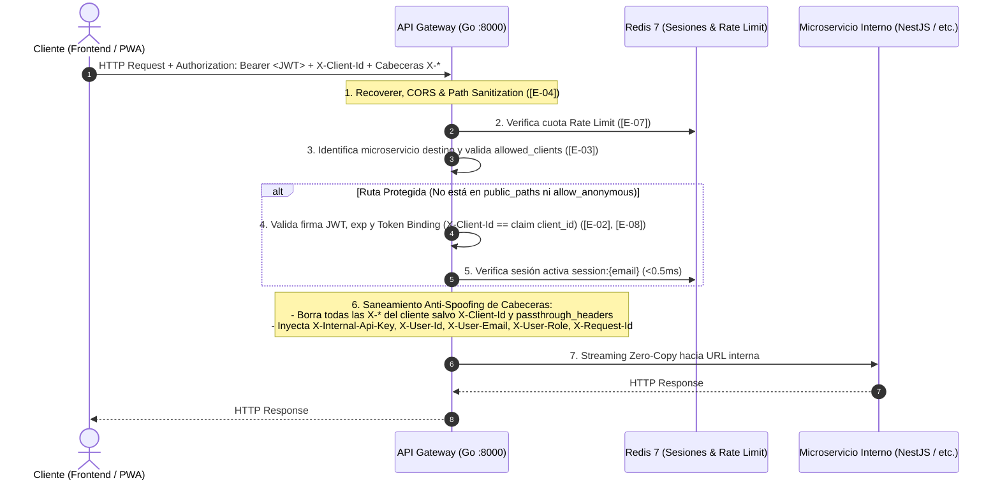

# 🏗️ Especificación Técnica: API Gateway & Auth (`SPEC_API_GATEWAY_AUTH.md`)
## Versión: 2.0.0 — Arquitectura Zero-Trust en Go 1.24+
**Estado:** Aprobado e Implementado en Producción  
**Rol / Enfoque:** Senior Backend Architecture, High-Performance Proxy & API Hardening  

---

## 1. Visión General (Overview)

El servicio `api-gateway-auth` es el **Punto de Entrada Único (Single Point of Entry)** y proveedor de identidad centralizado (IdP agnóstico) para el ecosistema de microservicios desplegado en Railway.

Sus responsabilidades fundamentales son:
1. **Interceptación Perimetral y Rate Limiting:** Recibir todo el tráfico externo (Web, PWA, Mobile) aplicando cuotas distribuidas en Redis.
2. **Identidad Centralizada Agnóstica (AuthN/AuthZ):** Gestionar credenciales (`email`, `password_hash` PBKDF2), emitir JWT con *Token Binding* (`client_id`), validar sesiones en Redis (<0.5 ms) y ofrecer endpoints M2M para creación/compensación de usuarios.
3. **Reverse Proxy Zero-Trust y Saneamiento Anti-Spoofing:** Enrutar mediante streaming *zero-copy* hacia la red privada interna, purgando cabeceras maliciosas del cliente, permitiendo únicamente cabeceras de contexto autorizadas (`passthrough_headers`) e inyectando cabeceras de identidad verificadas.

---

## 2. Arquitectura del Sistema y Flujo de Petición

### 2.1. Stack Tecnológico en Producción
* **Core & Concurrencia:** Go 1.24+, router `[github.com/go-chi/chi/v5](https://github.com/go-chi/chi/v5)` y `[github.com/go-chi/cors](https://github.com/go-chi/cors)`.
* **Base de Datos:** PostgreSQL 16 vía `[github.com/jackc/pgx/v5/pgxpool](https://github.com/jackc/pgx/v5/pgxpool)` configurado en *Simple Protocol* para compatibilidad con **PgBouncer** en *Transaction Mode*.
* **Caché, Sesiones & Rate Limiting:** Redis 7 vía `[github.com/redis/go-redis/v9](https://github.com/redis/go-redis/v9)` y `[github.com/go-redis/redis_rate/v10](https://github.com/go-redis/redis_rate/v10)`.
* **Seguridad:** `[github.com/golang-jwt/jwt/v5](https://github.com/golang-jwt/jwt/v5)` (HMAC-SHA256) y `golang.org/x/crypto/pbkdf2`.
* **Reverse Proxy:** `net/http/httputil.ReverseProxy` con soporte `io.LimitReader` para caché GET acotada en Redis (máx. 1 MB por entrada).

### 2.2. Flujo de Procesamiento Perimetral (Request Pipeline)



---

## 3. Configuración Zero-Trust de Microservicios (`MICROSERVICES`)

El Gateway se configura dinámicamente mediante la variable de entorno JSON `MICROSERVICES`. Opera bajo política **Deny by Default**: si un servicio no define `allowed_clients` (o está vacío), el acceso se bloquea con `403 Forbidden [E-03]`.

### 3.1. Esquema del Objeto `ServiceConfig` (`internal/config/config.go`)

| Propiedad JSON | Tipo en Go | Obligatorio | Descripción y Regla de Negocio |
| :--- | :--- | :---: | :--- |
| `url` | `string` | **Sí** | URL base interna del microservicio destino (ej. `http://localhost:4000` o `.railway.internal`). |
| `api_key` | `string` | No | Clave secreta inyectada en `X-Internal-Api-Key` hacia el microservicio. |
| `allowed_clients` | `[]string` | **Sí** | Lista de `client_id` autorizados (ej. `["reservas-web", "hostess-pwa"]` o comodín `["*"]`). |
| `required_roles` | `[]string` | No | Roles globales del Gateway admitidos (`"user"`, `"admin"`). Comparación insensible a mayúsculas/minúsculas. |
| `public_paths` | `[]string` | No | Lista de prefijos de sub-rutas accesibles sin token JWT (ej. `["/api/v1/marketplace"]`). |
| `allow_anonymous` | `bool` | No | Si es `true`, todas las rutas del microservicio permiten acceso sin autenticación. |
| `passthrough_headers` | `[]string` | No | **Lista blanca de cabeceras personalizadas (`X-*`)** que el Gateway permite pasar desde el cliente hacia este microservicio específico (ej. `["X-Restaurant-Id", "X-Timezone"]`). |

### 3.2. Ejemplo Canónico de Configuración en `.env`
```json
{
  "reservas": {
    "url": "http://localhost:4000",
    "api_key": "secret-key-reservas-123",
    "allowed_clients": ["reservas-web", "hostess-pwa"],
    "public_paths": ["/api/v1/marketplace", "/api/v1/auth/register", "/api/v1/reservations", "/api/v1/reviews"],
    "passthrough_headers": ["X-Restaurant-Id", "X-Timezone"]
  },
  "ventas": {
    "url": "http://localhost:8001",
    "api_key": "secret-key-ventas-123",
    "allowed_clients": ["comensales-app", "staff-pos", "admin-portal"]
  },
  "stock": {
    "url": "http://localhost:8002",
    "api_key": "secret-key-stock-456",
    "allowed_clients": ["staff-pos", "admin-portal"],
    "required_roles": ["user", "admin"]
  }
}
```

---

## 4. Política de Saneamiento de Cabeceras y Anti-Spoofing (`internal/proxy`)

Para mantener el Gateway 100% agnóstico a la lógica de negocio de los servicios aguas abajo sin abrir brechas de *Header Spoofing*, todo reenvío de peticiones ejecuta un algoritmo de filtrado en **3 fases**:

1. **Fase 1 — Purga de Cabeceras `X-*` No Autorizadas:**
   - El proxy inspecciona todas las cabeceras enviadas por el cliente externo.
   - Toda cabecera cuyo nombre comience con el prefijo `X-` (evaluado de forma case-insensitive) es **eliminada**, a menos que:
     - Sea `X-Client-Id` (validada por el Gateway), o
     - Esté explícitamente declarada en el arreglo `passthrough_headers` del microservicio destino (comparación case-insensitive, ej. `http.CanonicalHeaderKey`).
   - Adicionalmente, se rechaza o limpia cualquier valor de cabecera que contenga caracteres de inyección CRLF (`\r`, `\n`).

2. **Fase 2 — Protección Inmutable de Cabeceras Reservadas de Autoridad:**
   - Las siguientes cabeceras son **propiedad exclusiva del API Gateway** y conforman la **Lista Reservada Inmutable**:
     - `X-Internal-Api-Key`
     - `X-User-Id`
     - `X-User-Email`
     - `X-User-Role`
     - `X-Scopes`
     - `X-Request-Id`
   - **Regla de Blindaje:** Incluso si un administrador agregara por error una de estas cabeceras dentro de `passthrough_headers` en el `.env`, el Gateway **jamás** conservará el valor enviado por el cliente. Siempre las purga primero.

3. **Fase 3 — Inyección Fidedigna hacia el Microservicio:**
   - Si el servicio tiene `api_key`, se inyecta `X-Internal-Api-Key`.
   - Si la petición cuenta con una sesión autenticada válida, el Gateway inyecta `X-User-Id` (UUIDv4 inmutable), `X-User-Email`, `X-User-Role` (`"user"` o `"admin"`), `X-Client-Id` y `X-Scopes`.
   - Si la petición accede por una ruta pública (`public_paths` o `allow_anonymous`) sin token, las cabeceras `X-User-*` quedan completamente ausentes.

---

## 5. Contratos de Identidad y Autenticación (`/auth/*`)

### 5.1. Separación de Roles (IdP Agnóstico)
El Gateway únicamente gestiona **dos roles globales**:
- `"admin"`: Administrador de plataforma central. Solo aprovisionado por seed o entorno. Prohibida su creación vía API.
- `"user"`: Cualquier usuario autenticable de las aplicaciones cliente. Los roles finos de negocio (ej. `CUSTOMER`, `STAFF`, `HOSTESS`, `RESTAURANT_ADMIN`) pertenecen exclusivamente a la base de datos de cada microservicio downstream.

### 5.2. Endpoints de Autenticación y Gestión M2M
1. **`POST /auth/register` (Registro Público):**
   - Cabecera obligatoria: `X-Client-Id`.
   - Cuerpo JSON: `{"id": "uuid-opcional", "email": "...", "password": "..."}`.
   - Si el cliente envía `"id"` (UUIDv4 válido), se persiste ese UUID; si se omite, el Gateway genera uno nuevo. Rol asignado siempre: `"user"`.
2. **`POST /auth/login` (Inicio de Sesión):**
   - Requiere `X-Client-Id` (por header o en el body `client_id`, de lo contrario `400 [E-01]`).
   - Emite un JWT con vigencia estricta de **60 minutos** (sin refresh token) y guarda la sesión en Redis (`session:{email}`) con TTL de 60 minutos.
3. **`POST /auth/logout` (Cierre de Sesión / Invalidador de Redis):**
   - Cabecera obligatoria: `Authorization: Bearer <token>`, opcional `X-Client-Id` para validación de *Token Binding*.
   - Invalida y elimina la clave `session:{email}` en Redis para liberar memoria de inmediato sin esperar al TTL de 60 minutos.
   - **Contrato Idempotente:** Si la clave ya no se encuentra en Redis (por expiración previa o llamada repetida), responde igualmente con `200 OK` (`{"message": "Sesión finalizada exitosamente"}`) al cumplirse el estado deseado.
4. **`POST /auth/admin/users` (Creación M2M para Backends):**
   - Protegido con `X-Gateway-Secret`. Permite a los backends crear usuarios con `UUIDv4` pre-generado (`role: "user"`).
5. **`DELETE /auth/admin/users/:id` (Compensación / Rollback M2M):**
   - Protegido con `X-Gateway-Secret`. Elimina atómicamente una credencial cuando falla la transacción en el microservicio cliente.

---

## 6. Catálogo Oficial de Errores Perimetrales (`[E-xx]`)

Formato único de respuesta de error: `{"detail": "<Mensaje> [E-xx]"}`

| Código | HTTP Status | Mensaje Exacto en `"detail"` | Causa Interna |
| :---: | :---: | :--- | :--- |
| **`E-01`** | `400 Bad Request` | `"Cabeceras requeridas ausentes o no válidas [E-01]"` | Ausencia o formato inválido de `X-Client-Id` / `client_id`. |
| **`E-02`** | `401 Unauthorized` | `"Contexto de seguridad inconsistente [E-02]"` | *Token Binding Mismatch*: `X-Client-Id` difiere del claim `client_id` del JWT. |
| **`E-03`** | `403 Forbidden` | `"Acceso al recurso denegado [E-03]"` | `allowed_clients` vacío, cliente no autorizado para el servicio o rol insuficiente en `required_roles`. |
| **`E-04`** | `400 Bad Request` | `"Ruta de acceso inválida o no permitida [E-04]"` | Detección de *Path Traversal* (`..`, `.`), bytes nulos (`%00`) o caracteres ilegales. |
| **`E-05`** | `502 / 503` | `"Error de comunicación con el servicio de destino [E-05]"` | Microservicio interno caído, timeout o Circuit Breaker abierto. |
| **`E-06`** | `404 Not Found` | `"Recurso o servicio no encontrado [E-06]"` | Prefijo de microservicio o ruta inexistente. |
| **`E-07`** | `429 Too Many Requests`| `"Límite de peticiones excedido [E-07]"` | Cuota de Rate Limiting superada en Redis. |
| **`E-08`** | `401 Unauthorized` | `"No se pudieron validar las credenciales [E-08]"` | JWT ausente/expirado/inválido, sesión expirada en Redis o login incorrecto. |
| **`E-09`** | `403 Forbidden` | `"Permisos insuficientes para el recurso [E-09]"` | Intento de consumir endpoint administrativo sin rol `"admin"` o sin `X-Gateway-Secret` válido. |
| **`E-10`** | `400 / 422` | `"Formato de solicitud o cuerpo JSON no válido [E-10]"` | JSON malformado o tipos incompatibles. |
| **`E-11`** | `400 Bad Request` | `"Parámetros de solicitud no válidos [E-11]"` | Fallo en validación de email, longitud de contraseña o formato UUID. |
| **`E-12`** | `409 Conflict` | `"Conflicto con el recurso solicitado [E-12]"` | Email o UUID ya registrado en PostgreSQL. |
| **`E-13`** | `405 Method Not Allowed`| `"Método HTTP no permitido para este recurso [E-13]"` | Verbo HTTP no soportado en la ruta. |
| **`E-99`** | `500 Internal Error` | `"Error interno del servidor [E-99]"` | Fallo interno no controlado (traza asociada a cabecera `X-Error-ID`). |

---

## 7. Hoja de Ruta y Tareas Pendientes

El seguimiento detallado del backlog técnico, tareas pendientes, observabilidad y despliegues se gestiona de forma centralizada en [TODO.md](TODO.md).